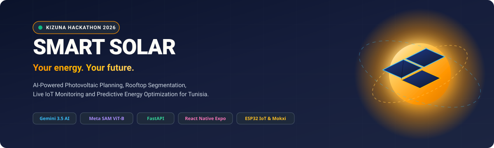
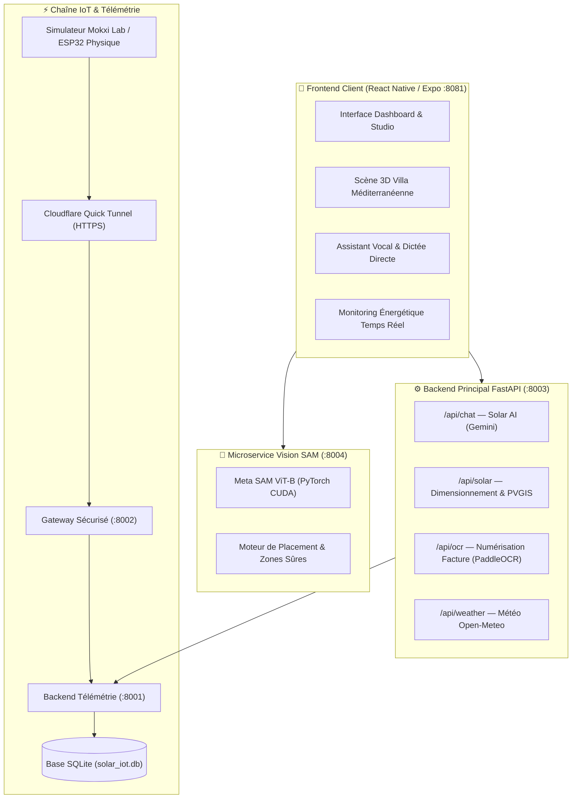
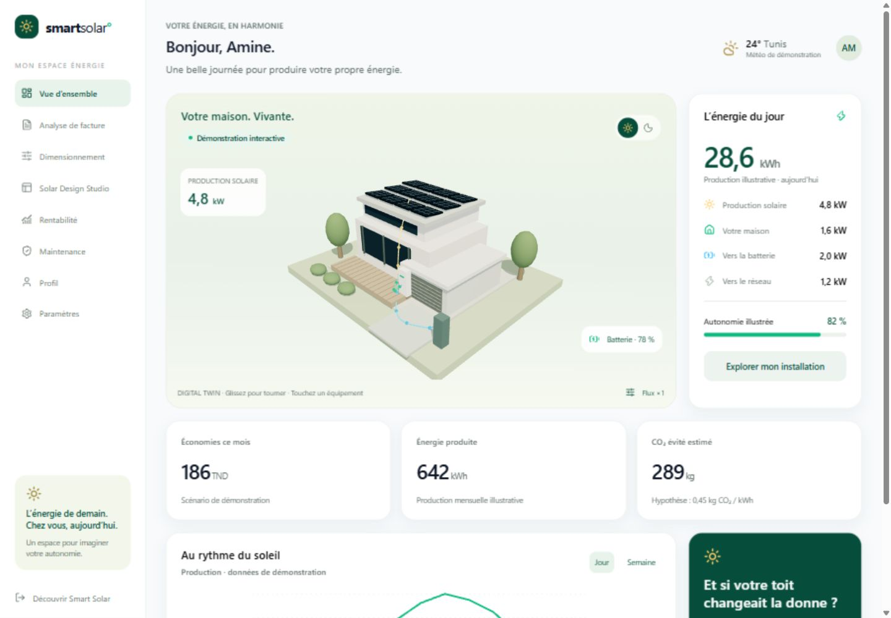
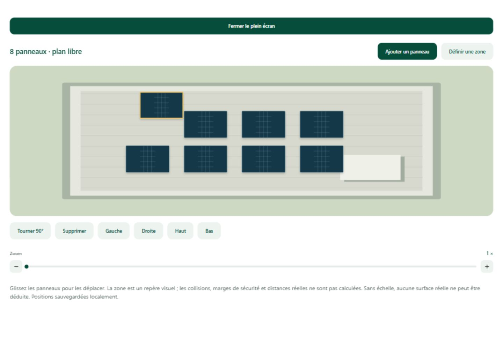
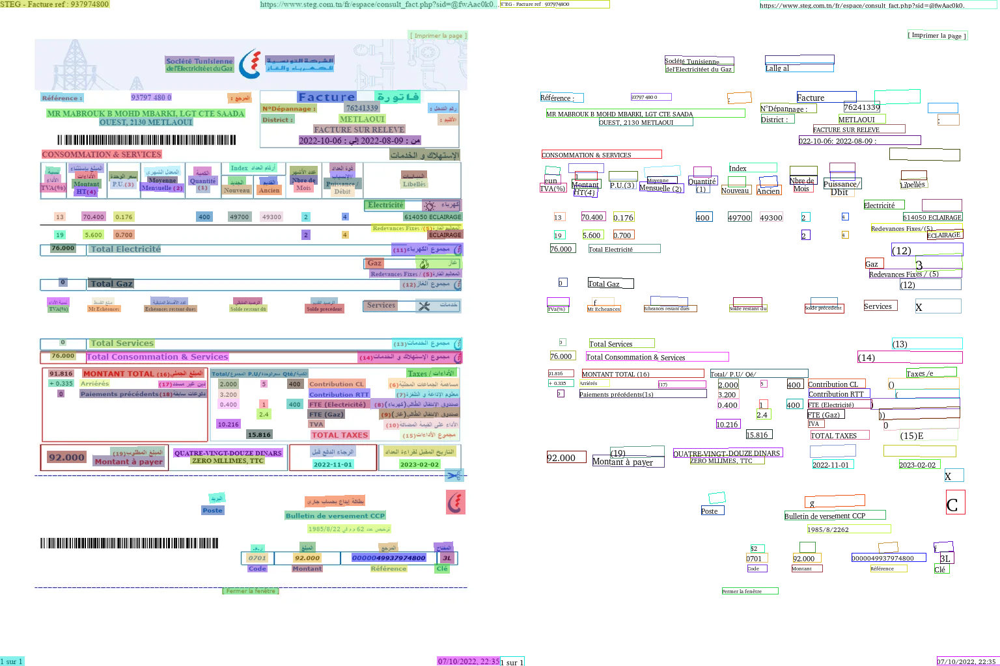
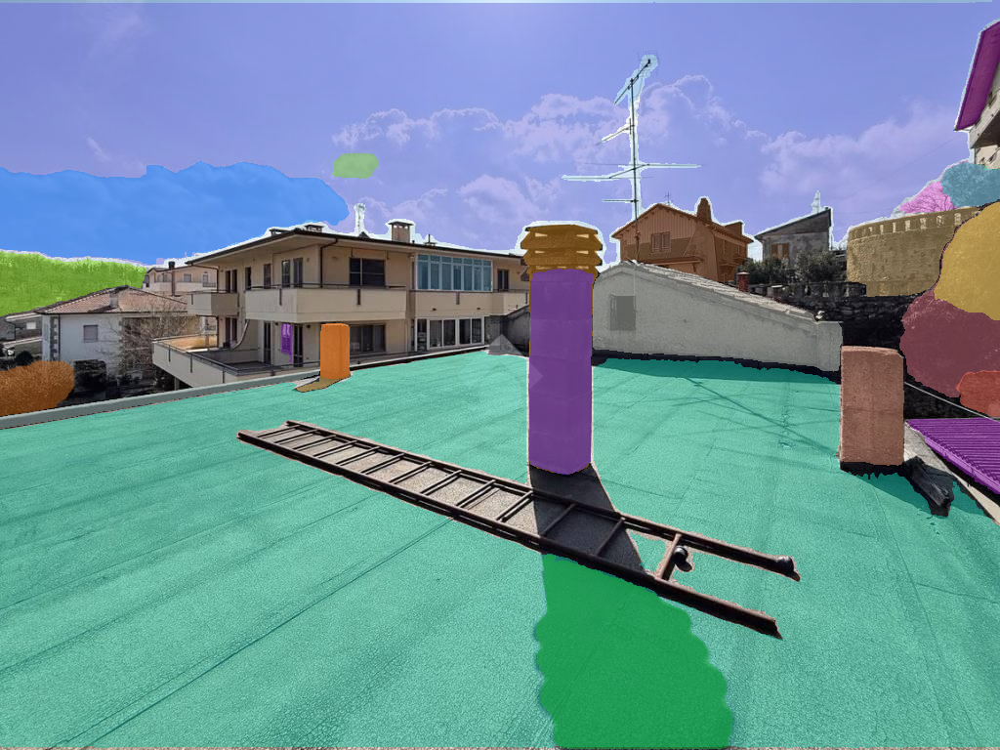
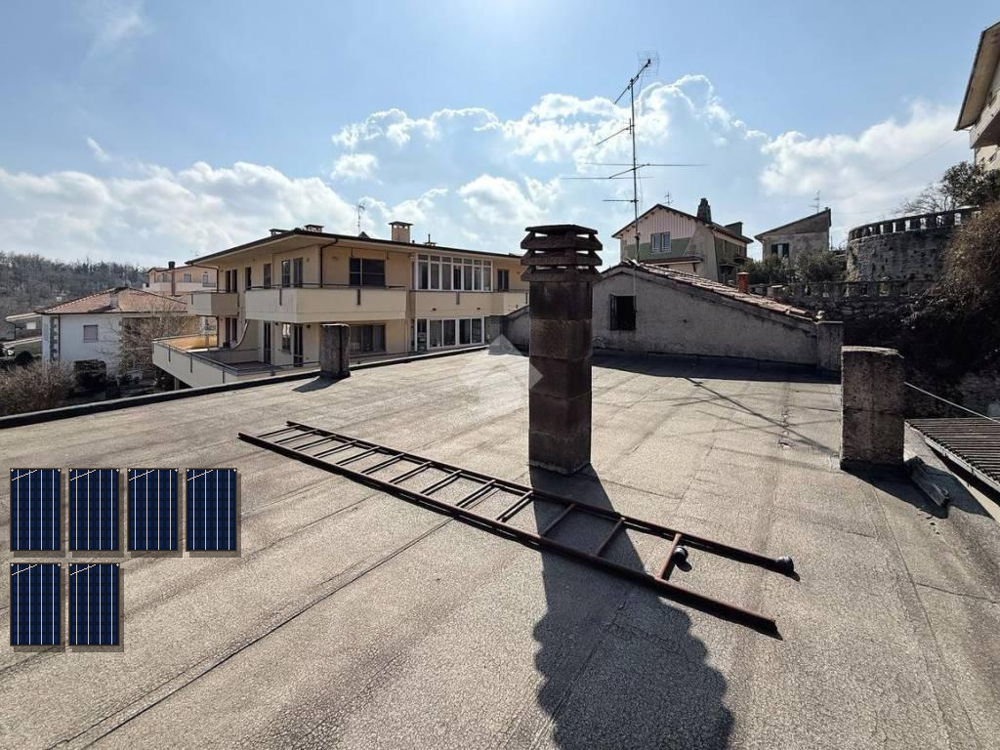

<p align="center">
  
</p>

# Smart Solar

**Your energy. Your future.**

*Une plateforme solaire intelligente propulsée par l'IA pour la planification photovoltaïque, la visualisation de toiture, le monitoring énergétique en temps réel et l'optimisation personnalisée de la consommation.*

---

## 📌 Aperçu du projet

**Smart Solar** est une plateforme technologique complète développée pour accompagner les foyers et entreprises tunisiennes avant, pendant et après l'installation de panneaux photovoltaïques.

En combinant la vision par ordinateur (**Meta Segment Anything ViT-B** sur GPU), les modèles de langage multimodaux (**Google Gemini 3.5 Flash** en dialecte tunisien Arabizi et français), la reconnaissance optique de factures (**PaddleOCR** pour les factures STEG) et une chaîne **IoT ESP32 connectée**, Smart Solar démocratise l'accès à l'énergie solaire en Tunisie.

---

## 🔍 La problématique

En Tunisie et dans le bassin méditerranéen, la transition solaire se heurte à plusieurs freins majeurs :
1. **Compréhension complexe des factures STEG** : paliers tarifaires progressifs difficiles à déchiffrer.
2. **Dimensionnement opaque** : difficulté à estimer la puissance crête nécessaire (kWc) sans déplacement d'un technicien.
3. **Visualisation absente** : impossibilité pour le client de visualiser l'implantation réaliste des panneaux sur son propre toit.
4. **Calculs financiers incertains** : rentabilité, temps de retour sur investissement (ROI) et économies souvent surévalués ou mal calculés.
5. **Absence de suivi post-installation** : manque de visibilité en temps réel sur la production et risque d'explosion de la consommation sans alerte prédictive.

---

## 💡 Notre solution

Smart Solar propose une expérience unifiée et modulaire :

- **Analyse intelligente de factures STEG** : extraction instantanée de la consommation mensuelle en kWh et du montant TTC via PaddleOCR.
- **Dimensionnement solaire personnalisé** : calcul automatique de la puissance crête recommandée (kWc), du nombre de panneaux et de la production annuelle.
- **Segmentation IA de toiture (Meta SAM ViT-B)** : détection automatique des pans de toiture exploitables et détourage des obstacles (cheminées, climatiseurs, paraboles).
- **Placement réaliste des panneaux** : moteur géométrique avec marge de sécurité de 0,5 m et orientation optimale selon l'azimut.
- **Solar Design Studio interactif** : studio 2D/3D permettant le dessin manuel de polygones ou l'ajustement assisté par IA.
- **Assistant conversationnel Solar AI** : conseiller expert parlant le dialecte tunisien (Arabizi) et le français, alimenté par Google Gemini.
- **Assistant vocal & dictée en direct** : transcription vocale continue apparaissant en direct dans la barre de saisie.
- **Monitoring IoT en temps réel (1s)** : transmission en direct de la tension, du courant et de la puissance depuis un micro-panneau solaire (ESP32 / Mokxi).
- **Moteur prédictif de dépassement** : scénario de référence (1200 / 900 / 15 / 30) calculant les dépassements de quota et conseillant un budget journalier restant.

---

## 🤖 Modes IA et Manuel

Smart Solar est conçu selon une architecture à double mode :
- **Mode Assisté par IA** : analyse en un clic de la facture par OCR, segmentation automatique de toiture par SAM ViT-B, disposition optimale des panneaux et conseils prédictifs par Solar AI.
- **Mode Contrôle Manuel** : saisie manuelle des données de consommation, dessin de polygones personnalisés sur le toit, réglage manuel du nombre de panneaux et sélection de l'azimut/inclinaison.

---

## 🛠️ Modèles IA et technologies

| Technologie | Rôle dans Smart Solar | Statut |
| :--- | :--- | :---: |
| **Meta SAM ViT-B** | Segmentation de toiture et masquage d'obstacles sur GPU CUDA | **Opérationnel** (4.94s, 26 masques) |
| **Google Gemini 3.5 Flash** | Raisonnement multimodal et conseiller solaire en Arabizi / Français | **Opérationnel** |
| **PaddleOCR (PP-OCRv4)** | Extraction des champs clés sur les factures STEG (kWh, Montant TTC) | **Opérationnel** |
| **U-Net Convolutionnel** | Modèle de segmentation de contours de toits (Keras / TensorFlow) | **Opérationnel** |
| **FastAPI** | Architecture microservices haute performance (Ports 8001, 8002, 8003, 8004) | **Opérationnel** |
| **React Native / Expo** | Application multiplateforme Web & Mobile (TypeScript strict) | **Opérationnel** (0 erreur) |
| **Three.js / React Three Fiber**| Visualisation 3D interactive d'une villa méditerranéenne avec flux solaire | **Opérationnel** |
| **ESP32 & Mokxi Lab** | Firmware IoT d'acquisition analogique (GPIO 34) et transmission Wi-Fi | **Opérationnel** |
| **Cloudflare Quick Tunnel** | Tunnel sécurisé HTTPS public pour la télémétrie IoT sans NAT | **Opérationnel** |
| **SQLite** | Persistance chronologique des métriques de puissance et d'énergie | **Opérationnel** |
| **Open-Meteo & PVGIS** | Données météorologiques en direct et irradiation solaire par satellite | **Opérationnel** |

---

## 🏛️ Architecture système



---

## 📸 Galerie de captures d'écran

Toutes les captures présentées ci-dessous proviennent des interfaces réelles de l'application :

| Dashboard & Villa 3D | Studio Toiture & Placement Solaire |
| :---: | :---: |
|  |  |

| Facture STEG Numérisée (OCR) | Segmentation IA SAM ViT-B | Placement Réaliste des Panneaux |
| :---: | :---: | :---: |
|  |  |  |

---

## ⚡ Démarrage rapide (Quick Start)

Smart Solar dispose d'un lanceur unifié automatique sous Windows :

1. **Cloner le projet** :
   ```bash
   git clone https://github.com/karimmlayah/Kizuna_Hackathon.git
   cd Kizuna_Hackathon
   ```
2. **Configurer l'environnement** :
   ```bash
   copy .env.example backend\.env
   ```
3. **Vérifier les modèles IA** :
   ```bash
   python scripts/download_models.py
   ```
4. **Lancer la plateforme** :
   Double-cliquez sur :
   ```cmd
   START_SMART_SOLAR.bat
   ```
   *(ou exécutez `.\start_smart_solar.ps1` sous PowerShell)*.

Le **Smart Solar Control Center** s'ouvre et supervise l'ensemble des 5 microservices. L'application Web est disponible immédiatement sur [http://localhost:8081](http://localhost:8081).

---

## 📊 Scénario de prédiction énergétique de référence

Pour la démonstration du jury Kizuna, le moteur prédictif évalue le scénario suivant :
- **Objectif mensuel de consommation** : 1 200 kWh
- **Consommation au jour 15/30** : 900 kWh
- **Projection en fin de mois** : 1 800 kWh
- **Dépassement attendu** : +600 kWh au-delà du quota
- **Recommandation immédiate de Solar AI** : Plafonner la consommation restante à **20 kWh/jour** sur les 15 jours restants afin d'éviter le palier STEG le plus onéreux.

---

## 📚 Documentation complémentaire

Pour une immersion technique complète, consultez les guides dédiés :
- 📐 [Architecture détaillée](docs/ARCHITECTURE.md)
- 💻 [Guide d'installation pas-à-pas](docs/INSTALLATION.md)
- 🔌 [Spécification des APIs REST](docs/API.md)
- ⚡ [Guide Hardware IoT & Mokxi](docs/IOT.md)
- 🧠 [Gestion des modèles IA & Poids](docs/MODELS.md)
- 🎯 [Guide de démonstration Hackathon (5 min)](docs/DEMO_GUIDE.md)
- 🧪 [Rapport de tests & Benchmarks](docs/TESTING.md)
- 📋 [Périmètre, limites & feuille de route](docs/LIMITATIONS.md)

---

## 🏆 Hackathon Kizuna 2026

Projet développé avec passion pour le **Kizuna Hackathon 2026**.

**Slogan** : *Your energy. Your future.*
