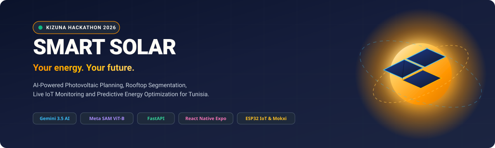
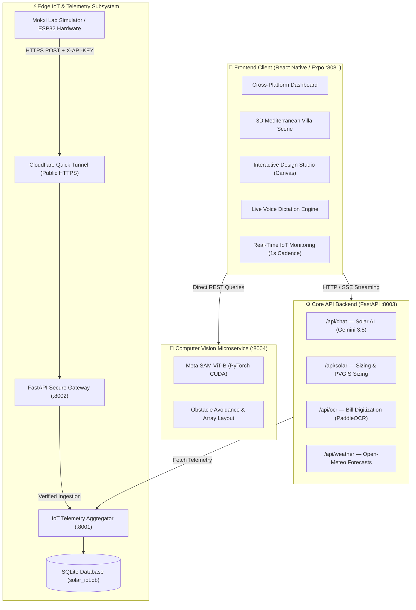
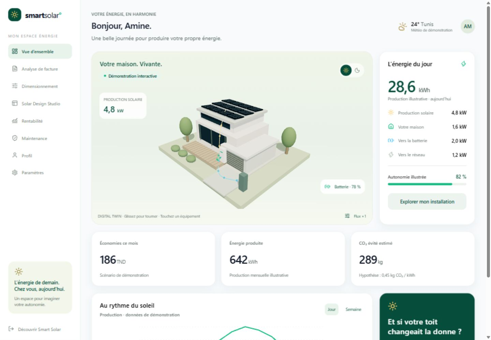
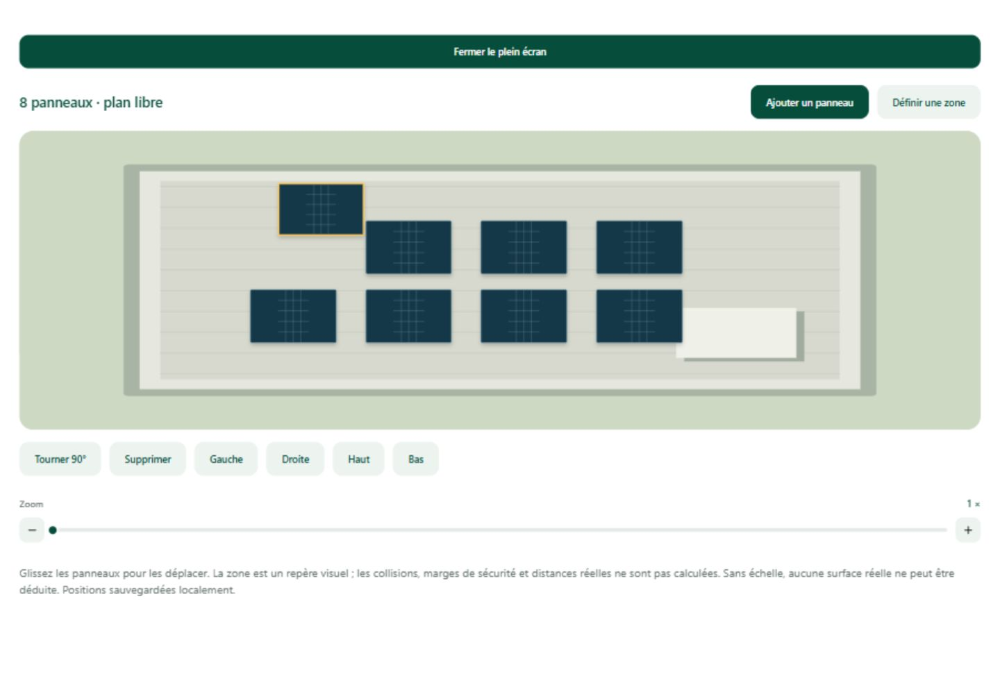
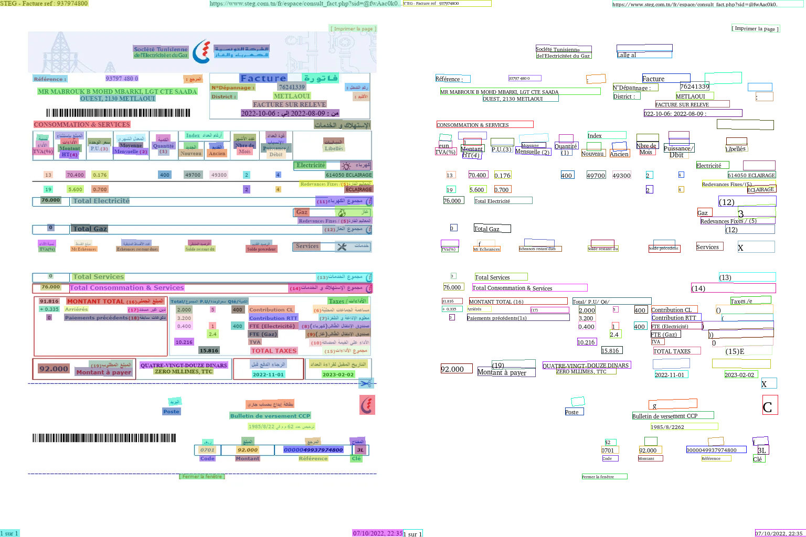
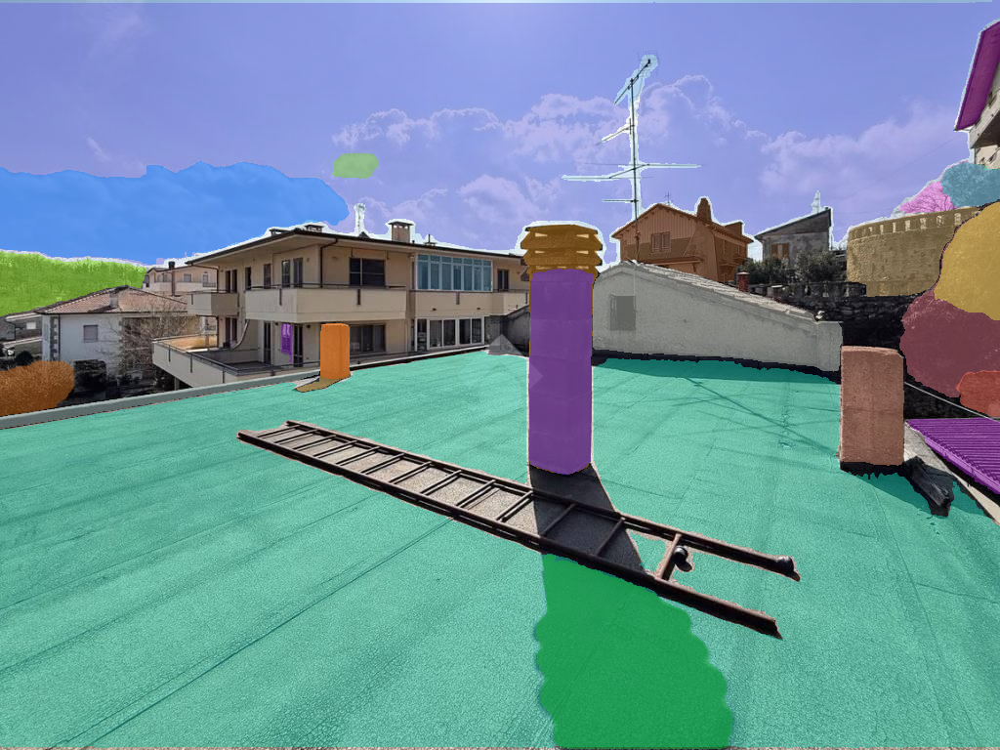
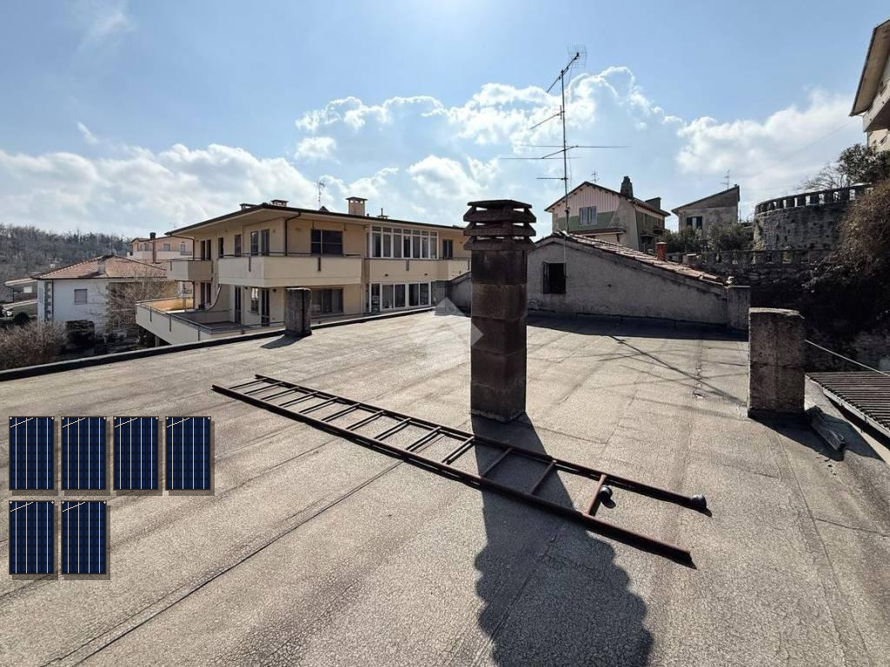

<p align="center">
  
</p>

# Smart Solar

**Your energy. Your future.**

An AI-powered solar energy platform for intelligent photovoltaic planning, rooftop visualization, real-time energy monitoring and personalized energy optimization.

[](https://github.com/karimmlayah/Kizuna_Hackathon)
[](frontend/)
[](backend/)
[](test_sam/)
[](backend/)
[](docs/TESTING.md)
[](README.fr.md)

---

## Table of Contents

- [Project Overview](#project-overview)
- [The Problem](#the-problem)
- [Our Solution](#our-solution)
- [AI & Manual Modes](#ai--manual-modes)
- [AI Models and Technologies](#ai-models-and-technologies)
- [System Architecture](#system-architecture)
- [Application Screenshots](#application-screenshots)
- [Installation](#installation)
- [Quick Start](#quick-start)
- [IoT Architecture](#iot-architecture)
- [Energy Prediction Engine](#energy-prediction-engine)
- [API Documentation](#api-documentation)
- [Project Structure](#project-structure)
- [Performance & Testing](#performance--testing)
- [Environmental & Social Impact](#environmental--social-impact)
- [Hackathon](#hackathon)
- [Demo Video](#demo-video)
- [Roadmap](#roadmap)
- [License](#license)
- [Documentation Index](#documentation-index)

---

## Project Overview

**Smart Solar** is an end-to-end clean technology platform designed to guide homeowners and commercial users through every phase of their solar energy journey: **before, during, and after** installation.

By combining state-of-the-art Computer Vision (**Meta Segment Anything ViT-B**), conversational generative intelligence (**Google Gemini 3.5 Flash** with native understanding of **Tunisian Arabizi** and French), utility invoice digitization (**PaddleOCR** for STEG bills), and edge hardware telemetry (**ESP32 micro-inverters & Mokxi Lab**), Smart Solar transforms solar adoption from an intimidating technical hurdle into an intuitive, empowering experience.

---

## The Problem

Across Tunisia and the Mediterranean region, residential and commercial solar adoption faces significant barriers:
- **Complex Utility Bills**: Deciphering progressive STEG tariff tiers (Tranche 1 to 4) is confusing for non-technical consumers.
- **Opaque System Sizing**: Determining the ideal peak capacity (kWp) traditionally requires on-site professional visits and expensive engineering tools.
- **Rooftop Visualization Gap**: Clients cannot preview how modern solar arrays will actually fit on their physical roofs before committing to major investments.
- **Financial Ambiguity**: Return on investment (ROI), payback timelines, and net savings are often overestimated or based on generic global assumptions rather than localized solar irradiance.
- **Absence of Post-Install Intelligence**: Homeowners receive monthly utility bills too late to prevent expensive consumption bracket overruns.

---

## Our Solution

Smart Solar offers a cohesive, modular platform addressing each stage of the lifecycle:


### Validated Operational Features
- **AI Electricity Bill Analysis**: Scans Tunisian STEG utility bills via PaddleOCR to extract monthly consumption (kWh) and billed totals (TND) automatically.
- **Intelligent Solar Sizing**: Computes recommended capacity (kWp), panel count, annual output (kWh), and financial payback using localized PVGIS satellite solar data.
- **AI Rooftop Segmentation (Meta SAM ViT-B)**: Automatically segments rooftop surfaces into candidate facets while identifying obstacles (chimneys, skylights, vents) in under 5 seconds on GPU.
- **Photorealistic Solar Panel Placement**: Rotates and places arrays along the optimal rooftop azimuth with enforced 0.5m setback safety buffers.
- **Interactive Solar Design Studio**: Full 2D/3D canvas supporting automatic AI placement and vertex-level manual polygon drawing.
- **Solar AI Conversational Assistant**: Multimodal reasoning agent fluent in Tunisian Arabizi and French, providing real-time solar guidance.
- **Live Voice-to-Text Dictation**: Continuous real-time voice recognition displaying spoken words progressively in the input bar.
- **Live Weather & Solar Irradiance**: Real-time cloud cover, temperature, and Solar Score (0–100) powered by Open-Meteo for Tunisian cities.
- **Edge IoT Energy Monitoring**: 1-second cadence telemetry stream capturing voltage, current, and wattage from simulated Mokxi ESP32 hardware.
- **Predictive Energy Alerts**: Deterministic monthly target projection engine warning users of imminent quota overruns.

### Experimental / In-Progress Features
- **Native Colloquial Audio Synthesis**: Dialect speech playback currently relies on phonetic Arabic-to-speech mapping rather than dedicated Tunisian acoustic models.
- **Commercial Modbus RTU / RS485 Inverter Protocol**: Physical hardware inverter communication for industrial installations.

---

## AI & Manual Modes

Smart Solar follows a dual-mode architectural philosophy:

```
┌─────────────────────────────────────────────────────────────┐
│                       SMART SOLAR                           │
├──────────────────────────────┬──────────────────────────────┤
│       AI-ASSISTED MODE       │         MANUAL MODE          │
├──────────────────────────────┼──────────────────────────────┤
│ • Automated STEG OCR parsing │ • Direct bill value inputs   │
│ • Zero-shot SAM segmentation │ • Custom polygon roof draw   │
│ • Algorithmic array layout   │ • Manual panel count & tilt  │
│ • Real-time voice dictation  │ • Standard text chat input   │
│ • Predictive budget warnings │ • User-defined target limits │
└──────────────────────────────┴──────────────────────────────┘
```

Users can effortlessly switch between AI recommendations and manual fine-tuning at any step without losing progress.

---

## AI Models and Technologies

| Technology | Role & Capability | Implementation & Benchmark |
| :--- | :--- | :--- |
| **Meta SAM (ViT-B)** | Rooftop facet segmentation & obstacle masking | PyTorch / CUDA — **26 masks in 4.94s** |
| **Google Gemini 3.5 Flash** | Multimodal conversational intelligence in Arabizi/French | Cloud API — Streaming SSE response |
| **PaddleOCR (PP-OCRv4)** | STEG electricity invoice digitization | PP-OCR MobileNetV3 / SVTR |
| **Convolutional U-Net** | Supervised rooftop boundary detection | Keras / TensorFlow checkpoint |
| **FastAPI** | High-performance decoupled microservice backends | Python 3.10+ (Ports 8001, 8002, 8003, 8004) |
| **Expo / React Native** | Cross-platform mobile and web responsive interface | Strict TypeScript (SDK 52/58, 0 errors) |
| **Three.js / R3F** | 3D contemporary Mediterranean villa visualization | WebGL PBR shaders + SVG native fallback |
| **ESP32 & Mokxi Lab** | Edge analog acquisition (GPIO 34) and Wi-Fi HTTPS client | C++ Arduino firmware |
| **Cloudflare Quick Tunnel** | Zero-configuration secure SSL tunnel for IoT demonstration | Public HTTPS endpoint routing |
| **SQLite** | Time-series electrical telemetry store | Local embedded relational database |
| **Open-Meteo & PVGIS** | Solar irradiance, satellite historical yield, live forecasts | REST API integrations |

---

## System Architecture



---

## Application Screenshots

All screenshots below represent actual running interfaces captured directly from Smart Solar:

| Interactive Dashboard & 3D Villa | Solar Design Studio (Array Layout) |
| :---: | :---: |
|  |  |

| STEG Invoice OCR Digitization | Meta SAM ViT-B AI Segmentation | Photorealistic Solar Panel Placement |
| :---: | :---: | :---: |
|  |  |  |

---

## Installation

### Prerequisites
- **Python**: 3.10 or 3.11
- **Node.js**: 18.x or 20.x LTS
- **NVIDIA GPU (Recommended)**: CUDA 11.8+ or 12.x for accelerated SAM ViT-B inference.
- **Git**

### 1. Clone the Repository
```bash
git clone https://github.com/karimmlayah/Kizuna_Hackathon.git
cd Kizuna_Hackathon
```

### 2. Configure Environment Variables
Copy `.env.example` to `backend/.env`:
```bash
copy .env.example backend\.env
```
Populate `backend/.env` with your free Google Gemini API key:
```env
GEMINI_API_KEY=your_gemini_api_key_here
GEMINI_BASE_URL=https://generativelanguage.googleapis.com/v1beta
GEMINI_MODEL=gemini-3.5-flash
SMART_SOLAR_IOT_API_KEY=ac8c3e4ff5d67f5806df8013beb439f2f311975ae923de7d
```

### 3. Verify / Download AI Models
```bash
python scripts/download_models.py
```

### 4. Install Dependencies
```bash
# Core Backend
cd backend && python -m venv .venv && .venv\Scripts\activate && pip install -r requirements.txt && cd ..

# Computer Vision SAM Microservice
cd test_sam && python -m venv .venv && .venv\Scripts\activate && pip install -r requirements.txt && cd ..

# IoT Telemetry Backend
cd iot && python -m venv .venv && .venv\Scripts\activate && pip install -r requirements.txt && cd ..

# Frontend Application
cd frontend && npm install && cd ..
```

*For step-by-step troubleshooting, consult [docs/INSTALLATION.md](docs/INSTALLATION.md).*

---

## Quick Start

We provide an automated launcher for Windows:

```cmd
START_SMART_SOLAR.bat
```
*(or run `.\start_smart_solar.ps1` via PowerShell)*.

This automatically boots:
1. IoT Backend on `http://localhost:8001`
2. IoT Secure Gateway on `http://localhost:8002`
3. Core Backend on `http://localhost:8003`
4. SAM AI CUDA Microservice on `http://localhost:8004`
5. Expo Frontend on `http://localhost:8081`
6. Opens the **Smart Solar Control Center** GUI.

Open **`http://localhost:8081`** in Google Chrome or Edge to launch the platform.

---

## IoT Architecture

Smart Solar bridges physical and simulated edge hardware to the application:

```
[Simulated 6V 1W Solar Panel in Mokxi Lab]
                   │
                   ▼ (Analog Voltage)
      [Voltage Divider: R1=10k, R2=20k]
                   │
                   ▼ (Max 2.0V safe input)
    [ESP32 DevKit V1 — Pin GPIO 34 (ADC)]
                   │
                   ▼ (Wi-Fi HTTPS POST + X-API-KEY)
      [Cloudflare Quick SSL Tunnel]
                   │
                   ▼
     [FastAPI IoT Gateway (Port 8002)]
                   │
                   ▼ (Validated Metrics)
    [FastAPI Telemetry Core (Port 8001)]
                   │
                   ▼
       [SQLite Database: solar_iot.db]
                   │
                   ▼ (1s Polling)
       [Smart Solar Monitoring Screen]
```

- **Mokxi Simulator Wi-Fi**: SSID `Mokxi-Lab`, Password `breadboard`.
- **Firmware Location**: [iot/mokxi/solar_esp32_wifi.ino](iot/mokxi/solar_esp32_wifi.ino).
- **Distinction**: Edge IoT metrics represent micro-scale generation from the test solar cell, while household consumption is tracked separately for utility quota analysis.

*For detailed electrical formulas and wiring schematics, see [docs/IOT.md](docs/IOT.md).*

---

## Energy Prediction Engine

The predictive engine continuously monitors household consumption against user targets to avoid costly tariff jumps.

### Kizuna Hackathon Reference Scenario:
- **Monthly Budget Target**: `1,200 kWh`
- **Mid-Month Usage (Day 15/30)**: `900 kWh`
- **Projected End-of-Month Usage**: `1,800 kWh`
- **Projected Excess Overrun**: `+600 kWh`
- **Intelligent Solar AI Advisory**: Restrict remaining consumption to **`20 kWh/day`** over the final 15 days to protect against the highest STEG tariff tier (>500 kWh).

---

## API Documentation

Interactive Swagger API docs are served locally across each microservice:
- **Core Backend**: [http://localhost:8003/docs](http://localhost:8003/docs)
- **SAM AI Microservice**: [http://localhost:8004/docs](http://localhost:8004/docs)
- **IoT Core Service**: [http://localhost:8001/docs](http://localhost:8001/docs)
- **IoT Gateway**: [http://localhost:8002/docs](http://localhost:8002/docs)

| Endpoint | Method | Service | Purpose |
| :--- | :---: | :---: | :--- |
| `/api/health` | `GET` | Core :8003 | Health check & service readiness |
| `/api/chat/status` | `GET` | Core :8003 | Inspect active Gemini LLM configuration |
| `/api/chat` | `POST` | Core :8003 | Multimodal chat with injected solar context |
| `/api/chat/stream` | `POST` | Core :8003 | Real-time SSE token streaming |
| `/api/solar/sizing` | `POST` | Core :8003 | PV sizing and financial payback calculations |
| `/api/ocr/bill` | `POST` | Core :8003 | Extract consumption & amount from STEG bills |
| `/roof/segment` | `POST` | SAM :8004 | Meta SAM ViT-B zero-shot rooftop segmentation |
| `/roof/plan` | `POST` | SAM :8004 | Collision-free solar array layout generation |
| `/api/iot/measurements` | `POST` | Gateway :8002 | Authenticated ingestion of ESP32 telemetry |
| `/api/iot/measurements/latest`| `GET` | IoT :8001 | Most recent electrical readings for dashboard |

*Complete request/response JSON schemas are documented in [docs/API.md](docs/API.md).*

---

## Project Structure

```
Kizuna_Hackathon/
├── START_SMART_SOLAR.bat       # 1-Click launcher for all microservices
├── STOP_SMART_SOLAR.bat        # Clean process shutdown utility
├── CHECK_SMART_SOLAR.bat       # Diagnostic & health inspection script
├── CONTROL_CENTER.bat          # Desktop GUI control center launcher
├── control_center.py           # Tkinter process & telemetry monitor
├── .env.example                # Public environment configuration template
├── .gitignore                  # Comprehensive secret & heavy weight filter
├── backend/                    # Core FastAPI Backend (Port 8003)
│   ├── main.py                 # FastAPI application entry point
│   ├── routers/                # API routers (chat, solar, ocr, weather)
│   ├── services/               # Gemini AI, OCR, and calculation services
│   └── tests/                  # Multi-turn scenario verification tests
├── test_sam/                   # Meta SAM ViT-B Microservice (Port 8004)
│   ├── sam_server.py           # PyTorch CUDA FastAPI microservice
│   └── test_images/            # High-resolution sample rooftop photos
├── iot/                        # Edge Telemetry & Hardware Subsystem
│   ├── api/                    # Gateway (:8002) and Telemetry Core (:8001)
│   ├── mokxi/                  # ESP32 Arduino C++ firmware
│   └── database/               # SQLite time-series storage
├── frontend/                   # React Native / Expo Application (:8081)
│   ├── app/                    # Expo Router route definitions
│   ├── features/               # Dashboard, Studio, Monitoring, Chat screens
│   ├── components/             # 3D canvas, VoiceOrb, energy charts
│   ├── scenes/                 # Three.js 3D Mediterranean Villa
│   └── tests/                  # Unit tests (sizing, prediction, voice)
├── scripts/                    # Automation utilities
│   └── download_models.py      # Automated public model downloader
└── docs/                       # Comprehensive technical documentation
    ├── ARCHITECTURE.md         # Detailed system architecture
    ├── INSTALLATION.md         # Full cross-platform setup guide
    ├── API.md                  # REST endpoint specifications
    ├── IOT.md                  # Hardware wiring & telemetry guide
    ├── MODELS.md               # AI model weights & licenses
    ├── DEMO_GUIDE.md           # 5-minute hackathon jury walkthrough
    ├── TESTING.md              # Quality assurance & test reports
    ├── LIMITATIONS.md          # Project scope & roadmap
    ├── assets/                 # SVGs and branding banners
    └── screenshots/            # Actual application interface captures
```

---

## Performance & Testing

Smart Solar is continuously tested with verified benchmarks:

- **TypeScript Typecheck**: `0 errors` (`tsc --noEmit`)
- **Frontend Unit Tests**: `11 / 11 tests passed (100%)`
- **SAM ViT-B CUDA Inference**: **4.94 seconds** on high-resolution imagery (26 facets extracted)
- **Solar AI Conversational Tests**: `5 / 5 multi-turn questions passed` in natural Tunisian Arabizi
- **Backend Latency**: Sub-10ms response on local calculation and telemetry endpoints

*Detailed reproduction commands and test logs are available in [docs/TESTING.md](docs/TESTING.md).*

---

## Environmental & Social Impact

Smart Solar directly aligns with the United Nations Sustainable Development Goals (**SDG 7: Affordable and Clean Energy**, **SDG 11: Sustainable Cities**, **SDG 13: Climate Action**):
- **Accelerating Decarbonization**: Each optimized residential solar installation in Tunisia mitigates approximately **4.1 tons of CO₂ annually**.
- **Financial Democratization**: Protects low- and middle-income families from sudden utility tariff surges.
- **Inclusive Technology**: First solar platform designed with native support for the Tunisian colloquial dialect (Arabizi) and voice-first interaction for non-technical users.

---

## Hackathon

Developed with excellence for the **Kizuna Hackathon 2026**.

- **Team**: Smart Solar Engineering Team
- **Track**: AI & CleanTech / Sustainable Energy
- **Location**: Tunisia

---

## Demo Video

*A high-definition walkthrough of Smart Solar is showcased during the live jury evaluation. Video demonstrations and slide presentations are cataloged in `docs/DEMO_GUIDE.md`.*

---

## Roadmap

- [x] Meta SAM ViT-B zero-shot rooftop segmentation on GPU.
- [x] Multimodal Solar AI conversational advisor with Tunisian Arabizi.
- [x] Live Voice-to-Text progressive transcription.
- [x] PaddleOCR STEG utility invoice parser.
- [x] Edge IoT ESP32 integration with Cloudflare Tunnel & Mokxi Lab.
- [x] Real-time 3D Mediterranean flat-roof villa visualization.
- [ ] Direct RS485 / Modbus protocol bridge for commercial inverters.
- [ ] Dedicated acoustic speech synthesis model fine-tuned on Tunisian Derja.
- [ ] P2P community solar microgrid trading platform.

---

## License

This project is developed for the **Kizuna Hackathon 2026**. All rights reserved by the Kizuna Hackathon Smart Solar Team.

Third-party models and libraries:
- **Meta Segment Anything**: Apache 2.0 License ([Meta AI Research](https://github.com/facebookresearch/segment-anything))
- **PaddleOCR**: Apache 2.0 License ([PaddlePaddle](https://github.com/PaddlePaddle/PaddleOCR))

---

## Documentation Index

- 📐 [Architecture Deep Dive](docs/ARCHITECTURE.md)
- 💻 [Step-by-Step Installation](docs/INSTALLATION.md)
- 🔌 [REST API Specifications](docs/API.md)
- ⚡ [Hardware & IoT Guide](docs/IOT.md)
- 🧠 [AI Model Management](docs/MODELS.md)
- 🎯 [5-Minute Jury Demo Guide](docs/DEMO_GUIDE.md)
- 🧪 [Testing & QA Report](docs/TESTING.md)
- 📋 [Limitations & Scope](docs/LIMITATIONS.md)
- 🇫🇷 [Version Française du README](README.fr.md)
