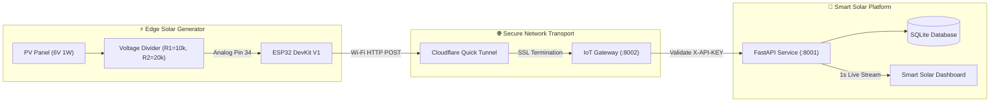

# IoT Architecture & Hardware Integration — Smart Solar

Smart Solar integrates an edge-to-cloud IoT pipeline connecting a simulated or physical photovoltaic panel to the central platform in real time.

---

## 1. Hardware & Simulation Architecture



---

## 2. Electrical Circuit & Acquisition

| Component | Specification | Description |
| :--- | :--- | :--- |
| **Micro-Controller** | ESP32 DevKit V1 | 240 MHz dual-core, integrated Wi-Fi 802.11 b/g/n, 12-bit ADC |
| **Simulated Panel** | 6V 1W Monocrystalline | Modeled inside Mokxi Lab simulator with variable irradiance |
| **Acquisition Pin** | GPIO 34 (ADC1_CH6) | High-precision analog input |
| **Resistor R1** | 10 kΩ | High-side resistor |
| **Resistor R2** | 20 kΩ | Low-side resistor to ground |
| **Divider Ratio** | $(R_1 + R_2) / R_2 = 1.5$ | Steps down 6.0 V peak to 4.0 V (with ADC 11dB attenuation) |

### Conversion Formulas:
$$\text{Raw ADC} \in [0, 4095]$$
$$V_{\text{pin}} = \frac{\text{Raw}}{4095} \times 3.3\,\text{V}$$
$$V_{\text{solar}} = V_{\text{pin}} \times \frac{R_1 + R_2}{R_2}$$
$$P_{\text{solar}} = V_{\text{solar}} \times I_{\text{calc}}$$

---

## 3. Mokxi Lab Simulation Setup

In virtual environments, Mokxi Lab simulates breadboard wiring, solar panel voltage outputs, and ESP32 Wi-Fi connectivity:

1. **Virtual Wi-Fi**:
   - SSID: `Mokxi-Lab`
   - Password: `breadboard`
2. **Firmware Location**:
   `iot/mokxi/solar_esp32_wifi.ino`
3. **Endpoint Configuration**:
   - For local loopback: `http://10.0.2.2:8002/api/iot/measurements`
   - For Cloudflare Tunnel: `https://<your-subdomain>.trycloudflare.com/api/iot/measurements`

---

## 4. Security & Gateway Authentication

To prevent spoofed metrics from polluting user analytics:
- Every HTTP POST from the ESP32 must include the custom header:
  ```
  X-API-KEY: <secure_hex_token>
  ```
- The **IoT Gateway (Port 8002)** rejects any unauthenticated request with `401 Unauthorized`.
- Valid packets are forwarded to the internal telemetry aggregator (**Port 8001**) and saved to SQLite (`iot/database/solar_iot.db`).

---

## 5. Micro-Production vs. Household Consumption

> [!NOTE]
> It is important to distinguish the two energy streams in Smart Solar:
> 1. **IoT Edge Stream**: Live measurements from the simulated Mokxi 6V 1W panel or physical sensor measuring instantaneous solar generation (Watts).
> 2. **Household Consumption Stream**: Historical utility data (e.g. STEG invoice) and user energy goals (e.g. 1,200 kWh monthly target), used by the predictive intelligence engine to forecast overruns.
