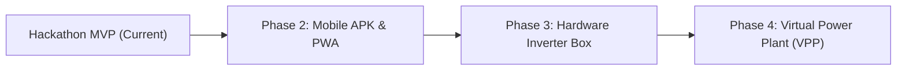

# Project Scope, Limitations & Future Roadmap — Smart Solar

In the spirit of technical transparency for the Kizuna Hackathon evaluation, this document clearly delineates between fully implemented and validated features versus experimental prototypes and future roadmap milestones.

---

## 1. Feature Status Matrix

| Module | Sub-Feature | Status | Verification Evidence |
| :--- | :--- | :---: | :--- |
| **Solar AI Chatbot** | Tunisian Arabizi & French reasoning | **Operational** | Tested with `backend/tests/test_5_questions.py` |
| **Solar AI Chatbot** | Streaming SSE generation | **Operational** | `stream_gemini_chat` with chunking |
| **Solar AI Voice** | Live Voice-to-Text dictation | **Operational** | Web Speech API + continuous transcript typing |
| **Solar AI Voice** | Dialect Audio Speech Synthesis | *Experimental* | Phonetic Arabic / French browser TTS mapping |
| **Computer Vision** | Meta SAM ViT-B Rooftop Segmentation | **Operational** | 26 masks in 4.94s on local CUDA GPU |
| **Computer Vision** | U-Net Boundary Segmentation | **Operational** | Keras model checkpoint ready |
| **Design Studio** | Collision-free panel placement | **Operational** | Obstacle buffer avoidance & azimuth alignment |
| **Design Studio** | Manual Polygon & Box editing | **Operational** | Interactive canvas with draggable vertices |
| **OCR Digitization** | STEG Invoice parsing (kWh, TND) | **Operational** | Verified on sample bills (`outputs/facture_01.png`) |
| **IoT Telemetry** | ESP32 Wi-Fi & Mokxi simulation | **Operational** | ADC GPIO 34 acquisition, voltage divider |
| **IoT Telemetry** | Secure Gateway & Cloudflare Tunnel | **Operational** | `X-API-KEY` enforcement on Port 8002 |
| **IoT Telemetry** | 1-Second Cadence Dashboard Refresh | **Operational** | Polling hook in `frontend/features/Monitoring.tsx` |
| **Energy Prediction**| 1200 / 900 / 15 / 30 Reference Engine | **Operational** | Deterministic unit test in `iotPrediction.test.ts` |
| **3D Visualization** | Contemporary Flat-Roof Villa | **Operational** | React Three Fiber WebGL with SVG Native fallback |
| **Hardware Control** | Smart Inverter Modbus Protocol | *Planned* | Commercial grid-tie inverters (e.g. SMA/Huawei) |

---

## 2. Technical Boundaries & Edge Cases

### A. Voice Dialect Synthesis
- *Current Implementation*: The dictation engine supports real-time voice-to-text in Arabizi. When speaking answers, the system converts Arabizi numerals (3, 7, 9, 5) and terms into phonetic Arabic, played back via the client's synthesized voice.
- *Limitation*: Standard Web Speech TTS voices in browsers are typically Modern Standard Arabic or French rather than colloquial Derja.
- *Planned Solution*: Fine-tuned local or cloud TTS model trained specifically on Tunisian phonology.

### B. SAM ViT-B GPU Acceleration
- *Current Implementation*: Preloaded in CUDA VRAM on port 8004.
- *Limitation*: Systems lacking a dedicated NVIDIA GPU fall back to CPU inference, which increases execution time from ~5s to ~30-45s for 1024x768 images.
- *Mitigation*: A lightweight mobile-SAM or U-Net model is provided as an alternative fast option for CPU environments.

### C. STEG Invoice Formats
- *Current Implementation*: PaddleOCR is calibrated for standard STEG residential low-voltage invoices.
- *Limitation*: Severely degraded, crumpled, or low-contrast physical paper photos may require manual field adjustment by the user in the UI.

---

## 3. Product Roadmap

1. **Phase 2 (Q2 2026)**: Production mobile application release on Google Play and Apple App Store with native camera document scanning.
2. **Phase 3 (Q3 2026)**: Direct Modbus RTU / RS485 integration for standard residential solar inverters (Growatt, Huawei, Fronius).
3. **Phase 4 (2027)**: Community peer-to-peer renewable energy trading platform (Virtual Power Plant) under evolving Tunisian energy regulations.
